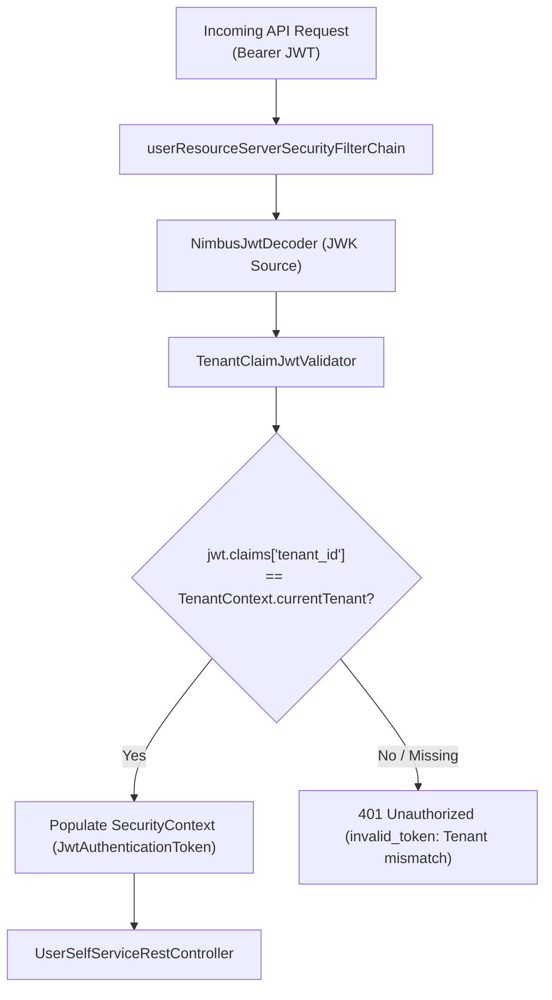

# Feature 13 — User Profile & Credential Self-Service (OAuth 2.1 Resource Server)

`ed-idp` provides an OAuth 2.1 Resource Server API and Web UI enabling authenticated end-users to inspect and update their profile metadata, manage dynamic profile attributes, and perform in-session password updates with strict multi-tenant data isolation.

---

## 1. Architecture & Design Principles

The self-service feature is decoupled into an OAuth 2.1 Resource Server within `ed-idp-core` (`users` slice) consumed by clients via Bearer tokens, keeping administrative and self-service capabilities securely segregated from core token issuance:

- **OAuth 2.1 Resource Server Architecture**: Endpoints are secured under a dedicated Spring Security filter chain (`@Order(3)`) requiring JWT Bearer token authentication signed by `ed-idp`'s JWK key set.
- **Strict Multi-Tenancy**: The JWT's `tenant_id` claim is matched against the resolved request tenant (`TenantContext`) via `TenantClaimJwtValidator`. Cross-tenant token replay attacks are blocked immediately with `401 Unauthorized`.
- **Dynamic Path Rewriting**: Both direct canonical paths (`/api/v1/users/me/**`) and tenant-qualified paths (`/t/{tenant}/api/v1/users/me/**`) are seamlessly supported and resolved.
- **Granular OAuth Scopes**: Fine-grained authorization prevents privilege escalation across read, profile update, and credential operations.

---

## 2. Security Filter Chain Configuration

The Resource Server filter chain sits at `@Order(3)` in `SecurityConfig`:

| Order | Chain | Matched Paths | Authentication / Authorization |
|---|---|---|---|
| `@Order(1)` | `tenantMachineEndpointsFilterChain` | `/t/{tenant}/oauth2/introspect`, `/t/{tenant}/oauth2/revoke` | `permitAll()` (M2M programmatic auth) |
| `@Order(2)` | `authorizationServerSecurityFilterChain` | Spring Authorization Server endpoints (`/oauth2/*`, `/oauth2/authorize-consent`) | Form login / SAS configurer |
| **`@Order(3)`** | **`userResourceServerSecurityFilterChain`** | **`/api/v1/users/me/**`** | **JWT Bearer Token (`OAuth2ResourceServerConfigurer`)** |
| `@Order(4)` | `introspectionFilterChain` | Canonical `/oauth2/introspect`, `/oauth2/revoke` | `permitAll()` (M2M programmatic auth) |
| `@Order(5)` | `defaultSecurityFilterChain` | Fallback / UI endpoints (`/`, `/login`, `/admin/**`, etc.) | Form Login (`LoginUrlAuthenticationEntryPoint`) |

---

## 3. Endpoints and Scope Authorization

All endpoints extract the user identity from the JWT `sub` (subject) claim and evaluate granted scopes:

| Method | Endpoint | Required Scope(s) | Description |
|---|---|---|---|
| `GET` | `/api/v1/users/me`<br>`/t/{tenant}/api/v1/users/me` | `SCOPE_profile` | Retrieves user profile metadata and custom attributes. |
| `PUT` | `/api/v1/users/me`<br>`/t/{tenant}/api/v1/users/me` | `SCOPE_profile:write` **or** `SCOPE_account:manage` | Updates user profile fields (`name`, `department`, `locale`, `zoneinfo`) and replaces custom attributes. |
| `POST` | `/api/v1/users/me/password`<br>`/t/{tenant}/api/v1/users/me/password` | `SCOPE_password:write` **or** `SCOPE_account:manage` | Validates the current password and safely updates the user's password using the configured password encoder. |

---

## 4. Multi-Tenant JWT Validation (`TenantClaimJwtValidator`)

To ensure tenant isolation across token validation, `ed-idp` registers a custom `OAuth2TokenValidator<Jwt>`:



If an access token issued for tenant `tenant-a` is submitted to `/t/tenant-b/api/v1/users/me`, the validator rejects it with:
```
OAuth2Error("invalid_token", "The token was not issued for tenant: tenant-b", null)
```

---

## 5. API Contracts

### 5.1 GET `/api/v1/users/me`

**Response (`200 OK`)**:
```json
{
  "username": "demo-user",
  "name": "Demo User",
  "email": "demo@example.com",
  "emailVerified": true,
  "locale": "en-US",
  "zoneinfo": "America/New_York",
  "department": "Engineering",
  "tenant": "demo",
  "attributes": {
    "favorite_color": "blue",
    "employee_level": "senior"
  }
}
```

### 5.2 PUT `/api/v1/users/me`

**Request Body**:
```json
{
  "name": "Demo User Updated",
  "locale": "en-GB",
  "zoneinfo": "Europe/London",
  "department": "Platform Architecture",
  "attributes": {
    "favorite_color": "green",
    "theme": "dark"
  }
}
```

**Response (`200 OK`)**: Returns the updated `UserProfileResponse`.

### 5.3 POST `/api/v1/users/me/password`

**Request Body**:
```json
{
  "currentPassword": "password",
  "newPassword": "NewSecurePassword123!"
}
```

**Responses**:
- `204 No Content`: Password successfully updated.
- `400 Bad Request`: Incorrect `currentPassword` or invalid `newPassword`.

---

## 6. Seeded Portal Client & Scopes

For development and portal integration, `ClientBootstrapService` registers `ed-idp-account-portal`:

- **Client ID**: `ed-idp-account-portal`
- **Authorized Grant Types**: `authorization_code`, `refresh_token`
- **Client Authentication**: `none` (PKCE Public Client)
- **Granted Scopes**: `openid`, `profile`, `email`, `profile:write`, `password:write`, `account:manage`
- **Redirect URIs**: `http://127.0.0.1:9000/account/callback`, `http://localhost:9000/account/callback`

---

## 7. Web UI Profile Menu (`ed-idp-ui`)

In addition to the REST API, `ed-idp-ui` provides a self-service management interface accessible to logged-in users:

- **Path**: `/admin/profile`
- **Controller**: `UserProfileController`
- **Service**: `UserProfileService` / `JdbcUserProfileService`
- **Navigation**: "Profile" item added to the sidebar navigation fragment (`layout.html`), enabling direct password changes and profile metadata inspection.
