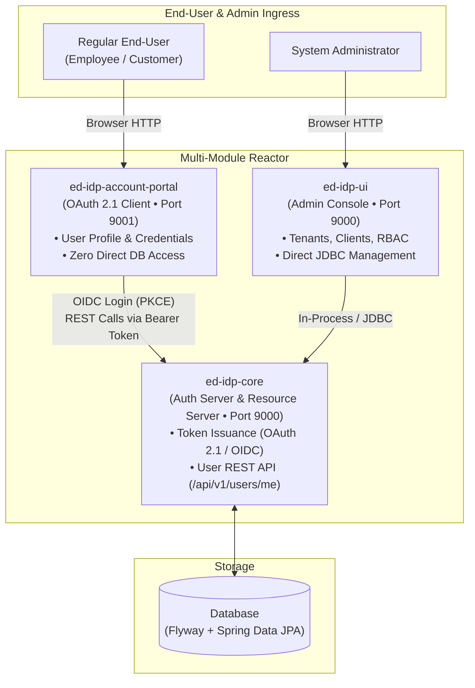

# Feature 14 — Standalone Account Portal (`ed-idp-account-portal`)

`ed-idp-account-portal` is a dedicated, user-facing self-service web application operating purely as an **OAuth 2.1 and OpenID Connect 1.0 Client Application**. It enables end-users (employees, customers) to inspect and update their profile details and change their password without touching administrative features or directly accessing the database.

---

## 1. Architectural Role & Topology

`ed-idp` cleanly separates operational responsibilities across three Maven modules:



### Key Differences Between Portal and Admin Console:
| Dimension | `ed-idp-account-portal` (User Portal) | `ed-idp-ui` (Admin Console) |
|---|---|---|
| **Audience** | Regular End-Users & Employees | Platform Administrators & DevOps |
| **Default Port** | `9001` | `9000` |
| **Authentication** | OAuth 2.1 & OIDC Authorization Code Flow with PKCE | Form Login with Session Cookie |
| **Data Access** | **Zero direct DB access**; calls `/api/v1/users/me` with Bearer tokens | Direct JDBC queries |
| **Security Scope** | Strictly limited to logged-in user's token (`sub`) | Broad administrative access across tenants |

---

## 2. OAuth 2.1 Client Configuration

The portal registers as an OAuth 2.1 Public Client (`ed-idp-account-portal`) with PKCE:

```properties
server.port=9001
spring.application.name=ed-idp-account-portal

# IdP Authorization Server Ingress
edidp.auth-server-url=http://localhost:9000

# Client Registration
spring.security.oauth2.client.registration.edidp.client-id=ed-idp-account-portal
spring.security.oauth2.client.registration.edidp.client-authentication-method=none
spring.security.oauth2.client.registration.edidp.authorization-grant-type=authorization_code
spring.security.oauth2.client.registration.edidp.redirect-uri={baseUrl}/login/oauth2/code/{registrationId}
spring.security.oauth2.client.registration.edidp.scope=openid,profile,email,profile:write,password:write,account:manage

# Provider Discovery Endpoints
spring.security.oauth2.client.provider.edidp.authorization-uri=${edidp.auth-server-url}/oauth2/authorize
spring.security.oauth2.client.provider.edidp.token-uri=${edidp.auth-server-url}/oauth2/token
spring.security.oauth2.client.provider.edidp.jwk-set-uri=${edidp.auth-server-url}/oauth2/jwks
spring.security.oauth2.client.provider.edidp.user-info-uri=${edidp.auth-server-url}/userinfo
spring.security.oauth2.client.provider.edidp.user-name-attribute=sub
```

---

## 3. REST API Integration (`AccountPortalApiClient`)

All user operations are performed by calling `ed-idp-core`'s OAuth 2.1 Resource Server REST API via Spring's `RestClient` using the user's active Bearer token:

- **`getProfile(accessToken, tenantId)`**:
  - Request: `GET /api/v1/users/me` (or `/t/{tenant}/api/v1/users/me`)
  - Headers: `Authorization: Bearer <token>`, `X-Tenant-ID: <tenant>`
  - Decodes into `UserProfileDto` (username, email, fullName, department, tenantId, roles, groups).
- **`updateProfile(accessToken, tenantId, request)`**:
  - Request: `PUT /api/v1/users/me` with JSON body `{ fullName, department }`
  - Scopes evaluated: `SCOPE_profile:write` or `SCOPE_account:manage`.
- **`changePassword(accessToken, tenantId, request)`**:
  - Request: `POST /api/v1/users/me/password` with JSON body `{ currentPassword, newPassword, confirmPassword }`
  - Scopes evaluated: `SCOPE_password:write` or `SCOPE_account:manage`.

---

## 4. User Experience & Features

1. **Profile Overview**: Displays avatar initial, username, primary email, department, tenant realm, and assigned roles/groups pills.
2. **Profile Editing**: Intuitive form to update display name and department.
3. **In-Session Password Change**: Password change card with client and server-side validation.
4. **Dark / Light Theme Toggle**: Persistent theme switcher using Bootstrap 5.3 `data-bs-theme` saved to `localStorage`.
5. **Session Termination**: Integrated Sign Out button redirecting to `/logged-out`.
