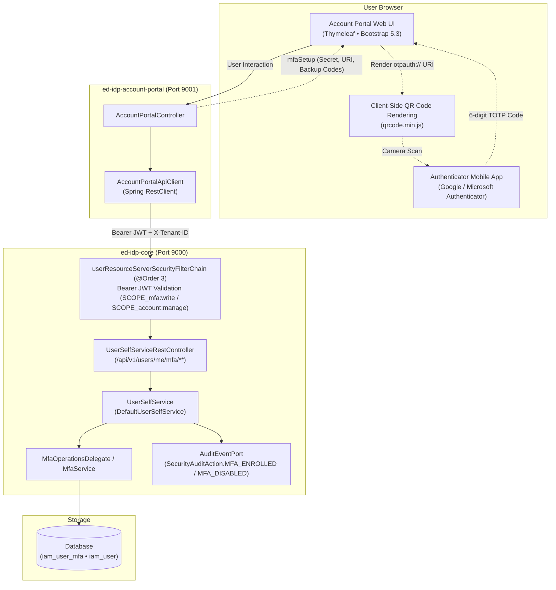

# Feature 16 — Self-Service MFA Enrollment (Account Portal)

`ed-idp` provides an end-to-end self-service Multi-Factor Authentication (MFA / 2FA) capability. Regular end-users can manage their RFC 6238 Time-Based One-Time Password (TOTP) enrollment directly through the standalone Account Portal (`ed-idp-account-portal`) via OAuth 2.1 Resource Server REST APIs (`ed-idp-core`), completely decoupled from administrative tooling and direct database operations.

---

## 1. Architectural Overview & Topology



---

## 2. Security & Scope Enforcement

The self-service MFA endpoints reside under `ed-idp-core`'s OAuth 2.1 Resource Server filter chain (`@Order(3)` in `SecurityConfig`):

| HTTP Method | Resource Server Endpoint | Required OAuth Scopes | Description |
|---|---|---|---|
| `GET` | `/api/v1/users/me/mfa`<br>`/t/{tenant}/api/v1/users/me/mfa` | `SCOPE_profile` **or** `SCOPE_account:manage` | Returns the user's current MFA enrollment status (`enabled`, `enrolledAt`). |
| `POST` | `/api/v1/users/me/mfa/setup`<br>`/t/{tenant}/api/v1/users/me/mfa/setup` | `SCOPE_mfa:write` **or** `SCOPE_account:manage` | Generates a pending TOTP secret key, `otpauth://totp/...` URI, and 8 single-use emergency backup recovery codes. |
| `POST` | `/api/v1/users/me/mfa/activate`<br>`/t/{tenant}/api/v1/users/me/mfa/activate` | `SCOPE_mfa:write` **or** `SCOPE_account:manage` | Verifies a 6-digit TOTP verification code and activates MFA for the account. |
| `POST` | `/api/v1/users/me/mfa/disable`<br>`/t/{tenant}/api/v1/users/me/mfa/disable` | `SCOPE_mfa:write` **or** `SCOPE_account:manage` | Verifies a valid TOTP code, emergency backup code, or existing password and disables MFA. |

---

## 3. Account Portal User Journey

### 3.1 Unenrolled User (Initial Setup)
1. **Overview**: The user navigates to `/account` and views the **Two-Factor Authentication (2FA)** card in the *Disabled* state.
2. **Initiation**: The user clicks **"Set Up Two-Factor Authentication"**, triggering `POST /account/mfa/setup`. The controller invokes `apiClient.initiateMfaSetup()` and receives the Base32 secret, QR code URI, and backup codes.
3. **Step 1 — Authenticator Pairing**:
   - The QR code is dynamically rendered in the DOM via `qrcode.min.js` without sending secret data to third-party QR generation services.
   - For desktop or manual entry, the Base32 secret key is displayed in monospace with a one-click **Copy Secret** button.
   - Mobile users can click **"Open in Authenticator"** to launch their installed authenticator app via URL scheme.
4. **Step 2 — Emergency Backup Codes**:
   - 8 single-use 8-character recovery codes are presented in a clean grid.
   - A **Copy All Codes** button copies all codes formatted as a newline-delimited list to the clipboard.
   - A warning alert reminds the user to store them safely.
5. **Step 3 — Verification & Activation**:
   - The user inputs the 6-digit code currently shown on their device and clicks **"Activate 2FA"** (`POST /account/mfa/activate`).
   - If verification succeeds, a success alert confirms activation and status changes to **Enabled**.
   - If verification fails (e.g. incorrect digits), an error alert is shown while preserving the current setup details in the wizard so the user can re-try without re-scanning.

### 3.2 Enrolled User (Management & Disablement)
1. **Status Inspection**: The user sees the green **"2FA Active"** status badge along with their enrollment timestamp.
2. **Disabling 2FA**:
   - The user expands the **"Disable Two-Factor Authentication"** section.
   - To guard against unauthorized session hijacking, the user must provide a valid 6-digit TOTP code, single-use recovery code, or their account password to confirm disablement (`POST /account/mfa/disable`).
   - Upon confirmation, MFA credentials and unconsumed backup keys are invalidated, and status returns to **Disabled**.

---

## 4. Structured Security Audit Logging

All self-service MFA actions trigger tamper-resistant security audit events via `AuditEventPort`:

| Action | Status | Audit Trigger | Logged Details |
|---|---|---|---|
| `MFA_ENROLLED` | `SUCCESS` | Successful TOTP code verification activating MFA | `principal`, `tenantId`, timestamp |
| `MFA_DISABLED` | `SUCCESS` | Verified code/password removing MFA | `principal`, `tenantId`, timestamp |
| `MFA_VERIFY_FAILURE` | `FAILURE` | Invalid code submitted during activation or disablement | `principal`, `tenantId`, error description |

---

## 5. REST API Specifications

### 5.1 GET `/api/v1/users/me/mfa`
**Headers**: `Authorization: Bearer <token>`, `X-Tenant-ID: <tenant>`

**Response (`200 OK`)**:
```json
{
  "enabled": true,
  "enrolledAt": "2026-11-04T00:00:00Z"
}
```

### 5.2 POST `/api/v1/users/me/mfa/setup`
**Headers**: `Authorization: Bearer <token>`, `X-Tenant-ID: <tenant>`

**Response (`200 OK`)**:
```json
{
  "secret": "JBSWY3DPEHPK3PXP",
  "qrCodeUri": "otpauth://totp/ed-idp:alice@example.com?secret=JBSWY3DPEHPK3PXP&issuer=ed-idp",
  "backupCodes": [
    "1a2b3c4d",
    "5e6f7a8b",
    "9c0d1e2f",
    "3a4b5c6d",
    "7e8f9a0b",
    "1c2d3e4f",
    "5a6b7c8d",
    "9e0f1a2b"
  ]
}
```

### 5.3 POST `/api/v1/users/me/mfa/activate`
**Request Body**:
```json
{
  "code": "123456"
}
```
**Response**: `204 No Content` (or `400 Bad Request` with `{"error": "bad_request", "error_description": "..."}`).

### 5.4 POST `/api/v1/users/me/mfa/disable`
**Request Body**:
```json
{
  "code": "123456"
}
```
**Response**: `204 No Content` (or `400 Bad Request` with `{"error": "bad_request", "error_description": "..."}`).
