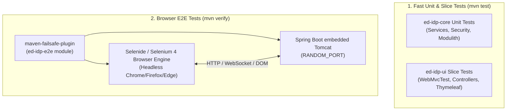

# How-To: End-to-End (E2E) Browser Automation Testing

This operational runbook explains how to execute, write, debug, and maintain automated End-to-End (E2E) browser tests in **ed-idp** using **Selenide** (Selenium 4), **JUnit 5**, and **Maven Failsafe**.

---

## 1. Architecture & Testing Strategy

The test suite in `ed-idp` follows a strict tier separation:



### Key Highlights
- **Zero Browser Overhead for Unit Builds**: `mvn test` runs only unit and controller-slice tests without launching any browser engine.
- **Dedicated Module**: All browser tests reside in `ed-idp-e2e` to isolate browser automation dependencies from production artifacts.
- **Dynamic Port Binding**: Tests run against a live Spring Boot server (`webEnvironment = SpringBootTest.WebEnvironment.RANDOM_PORT`) to eliminate TCP port collisions during concurrent CI/CD builds.
- **Seamless Local Execution**: Selenide uses your system's existing browser (Google Chrome, Firefox, Safari, or Microsoft Edge) via Selenium 4's built-in driver management, eliminating custom binary downloads or platform mismatch issues.
- **Automatic Diagnostics**: Every test failure automatically captures a full-viewport screenshot (`.png`) and DOM HTML snapshot into `target/selenide-reports/`.

---

## 2. Running E2E Tests

### Run Full Verification (Unit + E2E)
Executes all unit tests, starts the live server, runs all E2E integration tests, and calculates test coverage:

```bash
./mvnw clean verify
```

### Run Only E2E Tests
To skip earlier reactor modules and execute only the browser automation suite:

```bash
./mvnw verify -pl ed-idp-e2e
```

### Run a Single E2E Test Class
To run a specific test during development:

```bash
./mvnw test -pl ed-idp-e2e -Dtest=AdminConsoleLoginE2EIT -Dsurefire.failIfNoSpecifiedTests=false
```

Available test suites:
- `AdminConsoleLoginE2EIT`: Form login rendering, invalid credential alerts, admin authentication, and sign-out.
- `AdminClientsE2EIT`: Dynamic client provisioning, table updates, and dialog-confirmed deletion via HTMX.
- `AdminUsersE2EIT`: User provisioning via HTMX, table search, and subsequent login verification using new user credentials.
- `OAuth2PkceAuthorizationFlowE2EIT`: Complete RFC 7636 PKCE Authorization Code Grant flow in the browser with token exchange.
- `OAuthConsentFlowE2EIT`: Interactive scope review, selective scope deselect, approval token issuance, and denial handling.

---

## 3. Page Object Model (POM) Design

All browser interactions are encapsulated inside reusable Page Object classes under `io.github.edmaputra.edidp.e2e.pages`:

| Page Object | Path / Target | Responsibilities |
|---|---|---|
| `AdminLoginPage` | `/admin/login` | Fill login form, submit credentials, assert validation toasts and logout notices. |
| `AdminDashboardPage` | `/admin/dashboard` | Verify header metrics, navigate sidebar items (Clients, Users), sign out. |
| `AdminClientsPage` | `/admin/clients` | Register client records, assert table rows, handle confirmation dialogs (`Selenide.confirm()`), delete clients. |
| `AdminUsersPage` | `/admin/users` | Register users via HTMX, verify table presence, toggle user status. |
| `OAuthConsentPage` | `/oauth2/authorize-consent` | Inspect requesting client & principal, toggle scope checkboxes, trigger `approve()` or `deny()`. |

### Writing a New Page Object
Follow these design rules when creating or updating Page Objects:
1. Accept `String baseUrl` in constructor.
2. Return `this` or the next target Page Object on navigation/actions for fluent chaining.
3. Expose high-level user intents (`createUser(...)`, `approve()`) rather than raw selector lookups.

Example:
```java
public class AdminLoginPage {

  private final String baseUrl;

  public AdminLoginPage(String baseUrl) {
    this.baseUrl = Objects.requireNonNull(baseUrl, "baseUrl must not be null");
  }

  public AdminLoginPage navigate() {
    open(baseUrl + "/admin/login");
    return this;
  }

  public AdminDashboardPage loginAsAdmin(String email, String password) {
    $("#username").setValue(email);
    $("#password").setValue(password);
    $("button[type='submit']").click();
    Selenide.webdriver().shouldHave(urlStartingWith(baseUrl + "/admin/dashboard"));
    return new AdminDashboardPage(baseUrl);
  }
}
```

---

## 4. Writing an End-to-End Test

All E2E tests extend `BaseE2ETest`:

```java
package io.github.edmaputra.edidp.e2e.ui;

import static org.assertj.core.api.Assertions.assertThat;

import io.github.edmaputra.edidp.e2e.BaseE2ETest;
import io.github.edmaputra.edidp.e2e.pages.AdminDashboardPage;
import io.github.edmaputra.edidp.e2e.pages.AdminLoginPage;
import org.junit.jupiter.api.DisplayName;
import org.junit.jupiter.api.Test;

/**
 * Validates admin authentication and dashboard access.
 *
 * @author edmaputra
 * @since 0.0.1
 */
@DisplayName("Admin Console Login E2E")
class AdminConsoleLoginE2EIT extends BaseE2ETest {

  @Test
  @DisplayName("Should sign in as administrator and view dashboard")
  void shouldSignInAsAdmin() {
    AdminLoginPage loginPage = new AdminLoginPage(baseUrl());

    AdminDashboardPage dashboard = loginPage.navigate()
        .loginAsAdmin("admin@example.com", "admin-password");

    assertThat(dashboard.isDisplayed()).isTrue();
    assertThat(dashboard.getHeaderTitle()).contains("Overview Dashboard");

    AdminLoginPage loggedOutPage = dashboard.signOut();
    assertThat(loggedOutPage.getLogoutMessage()).contains("signed out");
  }
}
```

---

## 5. Test Reports & Diagnostics

### 5.1 Interactive HTML Test Report
During `./mvnw clean verify`, the `maven-surefire-report-plugin` automatically generates a comprehensive HTML test report summarizing all test results, success rates, and elapsed execution times:

```
ed-idp-e2e/target/reports/failsafe.html
```

To generate or view the HTML report on demand without re-running tests:
```bash
./mvnw surefire-report:failsafe-report-only -pl ed-idp-e2e
open ed-idp-e2e/target/reports/failsafe.html   # On macOS
# xdg-open ed-idp-e2e/target/reports/failsafe.html # On Linux
```

### 5.2 Failure Screenshots & DOM Snapshots
When an assertion or action fails, Selenide automatically captures diagnostics into `ed-idp-e2e/target/selenide-reports/`:

```
ed-idp-e2e/target/
└── selenide-reports/
    ├── <TestClass>/<testMethod>/<timestamp>.png   # Full viewport snapshot at failure moment
    └── <TestClass>/<testMethod>/<timestamp>.html  # Complete HTML DOM state at failure moment
```

---

## 6. Continuous Integration (GitHub Actions)

In `.github/workflows/ci.yml`, Selenide runs automatically with Google Chrome pre-installed on GitHub Actions runners without requiring external CLI or browser binary downloads:

```yaml
- name: Build and Verify with Maven
  run: ./mvnw clean verify -B

- name: Upload Test Reports (on failure)
  if: failure()
  uses: actions/upload-artifact@v7
  with:
    name: surefire-failsafe-reports
    path: |
      **/target/surefire-reports/**
      **/target/failsafe-reports/**
      **/target/selenide-reports/**
```
