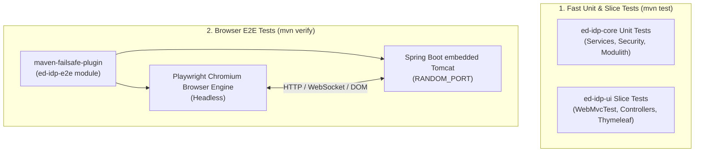

# How-To: End-to-End (E2E) Browser Automation Testing

This operational runbook explains how to execute, write, debug, and maintain automated End-to-End (E2E) browser tests in **ed-idp** using **Playwright Java**, **JUnit 5**, and **Maven Failsafe**.

---

## 1. Architecture & Testing Strategy

The test suite in `ed-idp` follows a strict tier separation:



### Key Highlights
- **Zero Browser Overhead for Unit Builds**: `mvn test` runs only unit and controller-slice tests without launching Playwright or Chromium.
- **Dedicated Module**: All browser tests reside in `ed-idp-e2e` to isolate heavyweight dependencies and Playwright node drivers from production artifacts.
- **Dynamic Port Binding**: Tests run against a live Spring Boot server (`webEnvironment = SpringBootTest.WebEnvironment.RANDOM_PORT`) to eliminate TCP port collisions during concurrent CI/CD builds.
- **Automatic Diagnostics**: Every test failure automatically captures a Playwright Trace (`.zip`), failure screenshot (`.png`), and execution video (`.webm`).

---

## 2. Running E2E Tests

### Run Full Verification (Unit + E2E)
Executes all unit tests, starts the live server, runs all E2E integration tests, and calculates test coverage:

```bash
./mvnw clean verify
```

### Run Only E2E Tests
To skip earlier reactor modules and execute only the browser automation suite:

```bash
./mvnw verify -pl ed-idp-e2e
```

### Run a Single E2E Test Class
To run a specific test during development:

```bash
./mvnw test -pl ed-idp-e2e -Dtest=AdminConsoleLoginE2EIT -Dsurefire.failIfNoSpecifiedTests=false
```

Available test suites:
- `AdminConsoleLoginE2EIT`: Form login rendering, invalid credential alerts, admin authentication, and sign-out.
- `AdminClientsE2EIT`: Dynamic client provisioning, table updates, and dialog-confirmed deletion via HTMX.
- `AdminUsersE2EIT`: User provisioning via HTMX, table search, and subsequent login verification using new user credentials.
- `OAuth2PkceAuthorizationFlowE2EIT`: Complete RFC 7636 PKCE Authorization Code Grant flow in the browser with token exchange.
- `OAuthConsentFlowE2EIT`: Interactive scope review, selective scope deselect, approval token issuance, and denial handling.

---

## 3. Page Object Model (POM) Design

All browser interactions are encapsulated inside reusable Page Object classes under `io.github.edmaputra.edidp.e2e.pages`:

| Page Object | Path / Target | Responsibilities |
|---|---|---|
| `AdminLoginPage` | `/admin/login` | Fill login form, submit credentials, assert validation toasts and logout notices. |
| `AdminDashboardPage` | `/admin/dashboard` | Verify header metrics, navigate sidebar items (Clients, Users), sign out. |
| `AdminClientsPage` | `/admin/clients` | Register client records, assert table rows, handle confirmation dialogs (`page.onceDialog(...)`), delete clients. |
| `AdminUsersPage` | `/admin/users` | Register users via HTMX, verify table presence, toggle user status. |
| `OAuthConsentPage` | `/oauth2/authorize-consent` | Inspect requesting client & principal, toggle scope checkboxes, trigger `approve()` or `deny()`. |

### Writing a New Page Object
Follow these design rules when creating or updating Page Objects:
1. Accept `Page page` and `String baseUrl` in constructor.
2. Return `this` or the next target Page Object on navigation/actions for fluent chaining.
3. Expose high-level user intents (`createUser(...)`, `approve()`) rather than raw selector lookups.

Example:
```java
public class AdminLoginPage {

  private final Page page;
  private final String baseUrl;

  public AdminLoginPage(Page page, String baseUrl) {
    this.page = Objects.requireNonNull(page, "page must not be null");
    this.baseUrl = Objects.requireNonNull(baseUrl, "baseUrl must not be null");
  }

  public AdminLoginPage navigate() {
    page.navigate(baseUrl + "/admin/login");
    return this;
  }

  public AdminDashboardPage loginAsAdmin(String email, String password) {
    page.locator("#username").fill(email);
    page.locator("#password").fill(password);
    page.locator("button[type='submit']").click();
    page.waitForURL("**/admin/dashboard");
    return new AdminDashboardPage(page, baseUrl);
  }
}
```

---

## 4. Writing an End-to-End Test

All E2E tests extend `BaseE2ETest`:

```java
package io.github.edmaputra.edidp.e2e.ui;

import static org.assertj.core.api.Assertions.assertThat;

import io.github.edmaputra.edidp.e2e.BaseE2ETest;
import io.github.edmaputra.edidp.e2e.pages.AdminDashboardPage;
import io.github.edmaputra.edidp.e2e.pages.AdminLoginPage;
import org.junit.jupiter.api.DisplayName;
import org.junit.jupiter.api.Test;

/**
 * Validates admin authentication and dashboard access.
 *
 * @author edmaputra
 * @since 0.0.1
 */
@DisplayName("Admin Console Login E2E")
class AdminConsoleLoginE2EIT extends BaseE2ETest {

  @Test
  @DisplayName("Should sign in as administrator and view dashboard")
  void shouldSignInAsAdmin() {
    AdminLoginPage loginPage = new AdminLoginPage(page(), baseUrl());

    AdminDashboardPage dashboard = loginPage.navigate()
        .loginAsAdmin("admin@example.com", "admin-password");

    assertThat(dashboard.isDisplayed()).isTrue();
    assertThat(dashboard.getHeaderTitle()).contains("Overview Dashboard");

    dashboard.signOut();
    assertThat(loginPage.isLogoutMessageDisplayed()).isTrue();
  }
}
```

---

## 5. Failure Artifacts & Debugging

When a test fails, `PlaywrightExtension` captures detailed diagnostic artifacts into `ed-idp-e2e/target/`:

```
ed-idp-e2e/target/
├── playwright-screenshots/
│   └── <TestClass>_<testMethod>.png    # Viewport snapshot at moment of failure
├── playwright-traces/
│   └── <TestClass>_<testMethod>.zip    # Complete DOM timeline, network waterfall & console logs
└── playwright-videos/
    └── <TestClass>_<testMethod>.webm   # Video playback of entire browser session
```

### Inspecting Traces with Playwright Trace Viewer
To inspect network requests, DOM snapshots, and console errors frame-by-frame:

```bash
npx playwright show-trace ed-idp-e2e/target/playwright-traces/OAuthConsentFlowE2EIT_shouldApproveSelectiveScopesAndIssueTokens.zip
```

---

## 6. Continuous Integration (GitHub Actions)

The CI workflow `.github/workflows/ci.yml` installs Playwright Chromium and automatically archives failure artifacts on build failure:

```yaml
- name: Install Playwright Browsers
  run: |
    npx playwright install --with-deps chromium

- name: Build and Verify with Maven
  run: ./mvnw clean verify

- name: Archive Playwright Failure Artifacts
  if: failure()
  uses: actions/upload-artifact@v4
  with:
    name: playwright-failure-diagnostics
    path: |
      ed-idp-e2e/target/surefire-reports/
      ed-idp-e2e/target/failsafe-reports/
      ed-idp-e2e/target/playwright-screenshots/
      ed-idp-e2e/target/playwright-traces/
      ed-idp-e2e/target/playwright-videos/
    retention-days: 7
```

---

## 7. Platform Specifics & Troubleshooting

### Ubuntu 26.04+ (Noble / Resolute) Platform Override
If running on newer Linux distributions where Playwright prints:
`ERROR: Playwright does not support chromium on ubuntu26.04-x64`

The Maven build is pre-configured with the environment override in `ed-idp-e2e/pom.xml`:
```xml
<environmentVariables>
  <PLAYWRIGHT_HOST_PLATFORM_OVERRIDE>ubuntu24.04-x64</PLAYWRIGHT_HOST_PLATFORM_OVERRIDE>
</environmentVariables>
```
If executing manually in a shell, export:
```bash
export PLAYWRIGHT_HOST_PLATFORM_OVERRIDE=ubuntu24.04-x64
```
